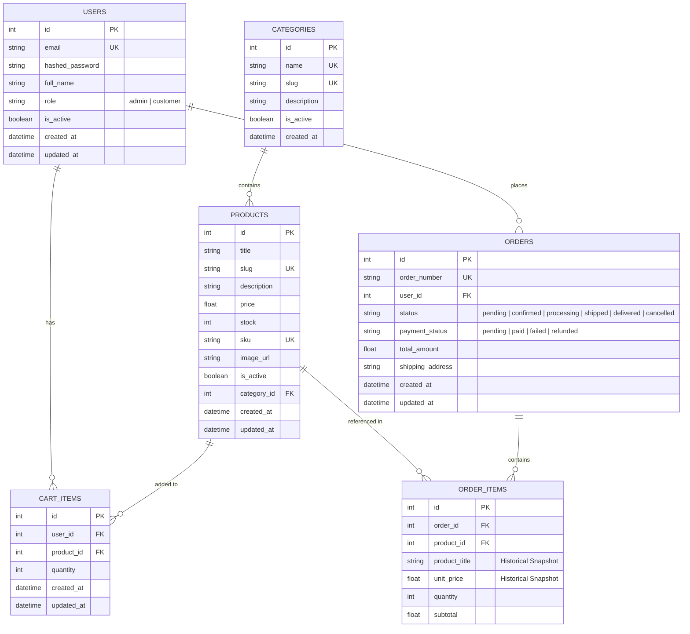

# 🛍️ E-Commerce REST API Backend

A production-grade, modular e-commerce RESTful backend engineered using **Python** and **FastAPI**, **SQLAlchemy ORM**, **Pydantic v2**, and **JWT Authentication**.

---

## 📌 Resume Alignment Matrix

| Resume Bullet Point | Architecture & Implementation in this Project |
| :--- | :--- |
| **Modular API Architecture** | Structured layered architecture: `app/api/v1/endpoints/` (controllers), `app/schemas/` (DTOs/validation), `app/crud/` (service/data access layer), `app/models/` (relational models), and `app/core/` (security, config). |
| **Request Validation** | Strict **Pydantic v2** models with constraints (`gt=0`, `ge=0`, `min_length`, regex email validation) and field sanitizers. |
| **Database Integration** | **SQLAlchemy** declarative models with connection pooling, foreign keys, cascade rules, and scoped session injection via FastAPI dependencies (`get_db`). |
| **Authentication & RBAC** | **JWT Bearer** token authentication (OAuth2 Password flow), salted password hashing, and Role-Based Access Control (`admin` vs `customer`). |
| **Product & Category Management** | Hierarchical categories with slugs, full-text product keyword search, category filtering, min/max price range, stock filters, and paginated catalog. |
| **Shopping Cart** | Persistent cart per user, real-time stock validation, incremental quantity adjustment, subtotal computation, and cart clearing. |
| **Order Management** | **Atomic checkout transaction** (stock validation, automatic inventory decrement, snapshot purchase price locking, order generation, cart clearance), status lifecycle, and order cancellation with inventory restoration. |
| **CRUD & Error Handling** | Dedicated CRUD repositories with clean separation, standard HTTP status codes (`201`, `204`, `400`, `401`, `403`, `404`, `409`, `422`), and comprehensive error responses. |
| **API Documentation** | Interactive OpenAPI 3.0 documentation automatically generated via Swagger UI (`/docs`) and ReDoc (`/redoc`) with tags, parameter descriptions, and response models. |

---

## 🧱 Relational Database Architecture



---

## 📦 Required Packages

Dependencies installed via `requirements.txt`:

```bash
pip install -r requirements.txt
```

### Dependency Breakdown:
- **`sqlalchemy`**: Relational database ORM, schema definition, and session management.
- **`pyjwt`**: JWT token creation, encoding, and signature verification.
- **`bcrypt`**: Password hashing.
- **`pydantic-settings`**: Environment variable loading (`.env`).
- **`python-multipart`**: Multipart/form-data support for file and image uploads.
- **`httpx` & `pytest`**: Automated testing of API endpoints with FastAPI's `TestClient`.

---

## 🚀 Quickstart Guide

### 1. Navigate to the backend directory
```bash
cd backend
```

### 2. Install dependencies
```bash
pip install -r requirements.txt
```

### 3. Seed Eyewear Collection (Lumos Optics)
Populates the database with 8 handcrafted frames across 4 categories, plus admin and customer accounts:
```bash
python seed.py
```
* **Admin Credentials:** `admin@ecommerce.com` / `adminpassword123`
* **Customer Credentials:** `customer@ecommerce.com` / `customerpassword123`

### 4. Optional: Cloudinary Configuration
To upload images to Cloudinary CDN, add credentials to `backend/.env`:
```env
CLOUDINARY_CLOUD_NAME=your_cloud_name
CLOUDINARY_API_KEY=your_api_key
CLOUDINARY_API_SECRET=your_api_secret
# Or use unsigned preset:
# CLOUDINARY_UPLOAD_PRESET=your_preset
```
*(Without Cloudinary credentials, uploads automatically fall back to saving in the local assets directory).*

### 5. Start the Development Server
```bash
uvicorn app.main:app --reload --port 8000
```
The server will start at `http://127.0.0.1:8000`.

### 6. Open API Documentation
* **Swagger UI:** [http://127.0.0.1:8000/docs](http://127.0.0.1:8000/docs)
* **ReDoc:** [http://127.0.0.1:8000/redoc](http://127.0.0.1:8000/redoc)

### 7. Run Automated Test Suite
```bash
pytest -v
```
Runs **17 automated unit and integration tests** verifying authentication, categories, products, image upload, cart operations, and atomic orders.

---

## 📂 Project Directory Structure

```
backend/
├── app/
│   ├── api/
│   │   ├── deps.py               # Dependency injection (get_db, auth & RBAC guards)
│   │   └── v1/
│   │       ├── api.py            # Aggregated v1 API router
│   │       └── endpoints/
│   │           ├── auth.py       # Register, Login (JSON & OAuth2), Me
│   │           ├── users.py      # User management & role assignment
│   │           ├── categories.py # Categories CRUD (Admin protected writes)
│   │           ├── products.py   # Products catalog, filtering, pagination
│   │           ├── cart.py       # Shopping cart operations & stock checks
│   │           └── orders.py     # Atomic checkout & order management
│   ├── core/
│   │   ├── config.py             # App settings & environment configs
│   │   └── security.py           # JWT token generation & password hashing
│   ├── db/
│   │   ├── base.py               # Declarative base & metadata registration
│   │   ├── session.py            # Database engine & sessionmaker
│   │   └── init_db.py            # Database tables initialization
│   ├── models/                   # SQLAlchemy ORM models
│   │   ├── user.py
│   │   ├── category.py
│   │   ├── product.py
│   │   ├── cart.py
│   │   └── order.py
│   ├── schemas/                  # Pydantic v2 validation models
│   │   ├── common.py
│   │   ├── user.py
│   │   ├── category.py
│   │   ├── product.py
│   │   ├── cart.py
│   │   └── order.py
│   ├── crud/                     # Reusable CRUD service repositories
│   │   ├── crud_user.py
│   │   ├── crud_category.py
│   │   ├── crud_product.py
│   │   ├── crud_cart.py
│   │   └── crud_order.py
│   └── main.py                   # FastAPI application factory & lifespan
├── tests/                        # Pytest suite
│   ├── conftest.py               # In-memory SQLite fixtures & mock clients
│   ├── test_auth.py
│   ├── test_categories.py
│   ├── test_products.py
│   ├── test_cart.py
│   └── test_orders.py
├── seed.py                       # Database seeding script
├── requirements.txt              # Project dependencies
├── .env.example                  # Environment configuration template
└── README.md
```

---

## 💡 Key Design & Interview Highlights

When explaining this project in an interview, emphasize these engineering decisions:

1. **Atomic Transactional Checkout (`crud_order.py`)**:
   * Checking out is executed in a single atomic database transaction.
   * Prevents race conditions and inventory overselling: validates all cart items against live stock before altering records.
   * Stores snapshot fields (`product_title`, `unit_price`) inside `order_items` so future product name or price changes never corrupt historical customer receipts.
   * If an order is cancelled prior to shipment, stock quantities are automatically restored.

2. **Role-Based Access Control (RBAC)**:
   * Endpoints use composable FastAPI dependencies (`Depends(get_current_user)` vs `Depends(get_current_admin)`).
   * Customers can only read/modify their own shopping cart and order history.
   * Administrative routes (creating products, updating categories, changing order delivery status) reject unprivileged requests with `403 Forbidden`.

3. **Defensive Request Validation & Slugs**:
   * Pydantic v2 schemas enforce boundaries (e.g. `price > 0`, `stock >= 0`, validated email format).
   * Slugs are auto-generated from product/category titles with automatic incrementation (`iphone-15`, `iphone-15-1`) to prevent collision.
